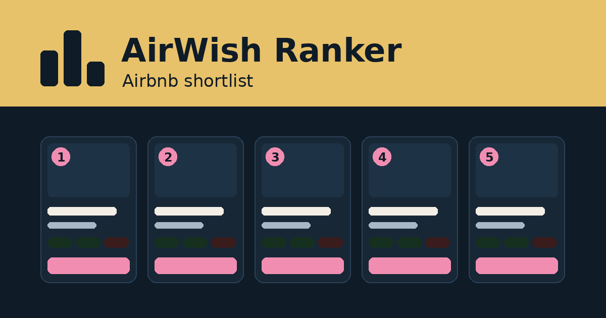

# AirWish Ranker

A Chrome extension that ranks every listing in an Airbnb wishlist, anywhere in the world, and shares a shortlist to any phone.

Open a wishlist, click **Rank this wishlist**, and a few minutes later every listing is tagged, scored in seven categories, and sortable, searchable and filterable. Pick up to five and send them to a phone as a link, a text message or a single page file.



## What it measures

| Category | Default weight | What goes in |
|---|---|---|
| Location | 22 | Guest location rating, walk to public transport, walk to the center, walkability, places to eat, sights, nightlife, sea or beach, lake or river, parks |
| Space & Sleep | 16 | Real-bed spots for your group (sofa beds, couches and mattresses don't count), number of real beds, bedrooms, bathrooms, guest headroom |
| Comfort & Amenities | 12 | Essentials (wifi, AC, kitchen, washer, heating...), step-free access, convenience (self check-in, parking...), extras (pool, hot tub, gym...) |
| Outdoor & Views | 8 | Best outdoor space (rooftop, terrace, garden, balcony, patio), best view (sea, lake, mountain, city) |
| Reviews & Trust | 20 | Rating trusted by review count, sub-ratings, red and green flags as a share of reviews, listing warnings, Superhost, cancellation |
| Value | 8 | Price per adult per night against the wishlist median |
| Our votes | 14 | Yes and No votes from everyone on the wishlist |

Location works anywhere OpenStreetMap has data: nothing is tied to a region. Walking times are routed on foot where possible. Every factor, weight, tag and curve is adjustable in Settings, with one button back to the defaults. The full math is in [extension/SPEC.md](extension/SPEC.md).

## Tags

110 tags in 12 groups: Essentials, Extras, Convenience, Outdoor, Views, Access, Sleep & bath, Location, Warnings, Status, Red flags, Green flags. Each can be required or excluded in the filters, and most carry weight in a score: amenity tags add coverage, outdoor and view tags carry a value, red and green flag tags carry a severity per review.

## Install

1. Download this repository (**Code → Download ZIP**) and unzip it somewhere permanent.
2. Open `chrome://extensions`, turn on **Developer mode**, click **Load unpacked** and pick the `extension` folder.
3. Log in to Airbnb, open any wishlist, click the AirWish Ranker icon, then **Rank this wishlist**.

To update, replace the files and click the reload arrow on the extension's card.

## Sharing to a phone

Tick up to five rows (or use the top five in the current view), click **Share to phone**, then:

- **Copy link**: opens as a page on any phone. The shortlist travels inside the link after the `#`, which browsers never send to the server, so nothing is stored anywhere. The page is served from [GitHub Pages](https://ajspaghetti.github.io/AirWish-Ranker/).
- **Copy text message**: one short block per listing with its Airbnb link, for any SMS app.
- **Download page file**: the same page as a single file with photos built in and no scripts, to attach in Messages or AirDrop.

## Privacy

Everything runs in your browser with your own Airbnb session. Review text is never stored, only which flags each review triggered. The only other requests go to OpenStreetMap services (coordinates only) and Airbnb's photo server (for the page file).

## Project layout

```
extension/        the Chrome extension (Manifest V3, plain JavaScript, no build step)
  background.js   learns Airbnb's page requests (operation, variables) as you browse
  collector.js    runs in the Airbnb tab: listing details, amenities, beds, review flags
  geo.js          OpenStreetMap points of interest and walking routes
  model.js        one clean record per listing
  tags.js         the tag dictionary
  scorer.js       factors, categories, presets, ranking
  share.js        share page, text and link encoding (also served from docs/s/)
  app.*           results page; popup.* toolbar popup
docs/             GitHub Pages: landing page and the share viewer (docs/s/)
```

## Credits

Map data © OpenStreetMap contributors (ODbL), via the Overpass API. Walking routes by Valhalla on the FOSSGIS servers. Not affiliated with Airbnb.
